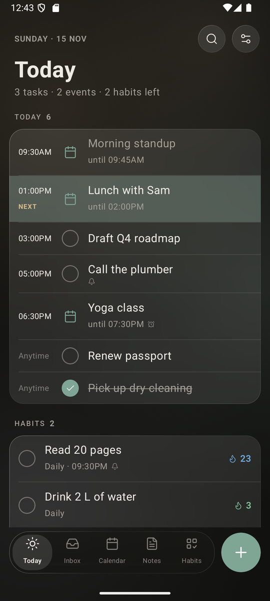
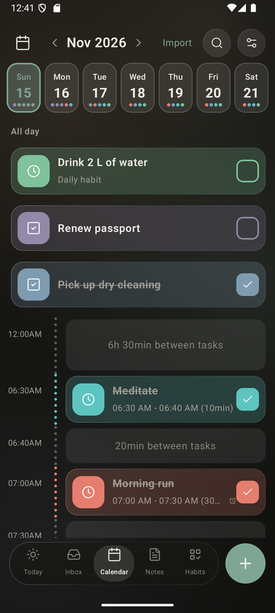
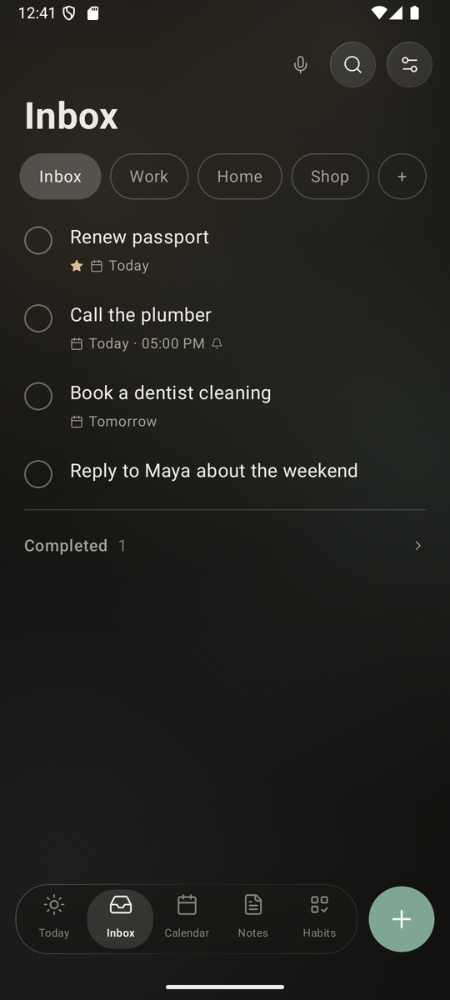

<p align="center">
  
</p>

<h1 align="center">Daymark</h1>

<p align="center">
  A calm, private planner for Android: to-dos, calendar, notes and habits in one place.<br>
  Everything stays on your phone.
</p>

<p align="center">
  <a href="../../releases/latest"><b>Download the latest APK</b></a>
  &nbsp;·&nbsp; Android 12 or newer
</p>

<p align="center">
  
  
  
  
</p>

## What it does

**Today** opens first: what's overdue, what's on today in time order, the habits you haven't checked in yet, and what's coming tomorrow.

**To-dos** live in folders (Inbox, Work, Home…). Add them by typing or by voice (tap the mic and speak; four small bars move with your voice while it listens), star the important ones, give them a date and time, and let them repeat daily, on weekdays, weekly, monthly or yearly.

**Calendar** shows a week strip and a timeline of the day, with tasks, events and habits together. Swipe through the days of the week, and pick which of your phone's calendars to show. Sync is two-way through Android's own calendar storage: events you make in Daymark (and, if you like, timed to-dos) are copied to one calendar you choose, such as your Google calendar, and edits go both ways. No Google sign-in is needed.

**Notes** are written as pages: headings, checklists, bullets, quotes, tables, images and drawings, with an optional cover image. Crop a picture before you add it, or use it as it is. Attach any other file too, such as a PDF, a voice recording, a video or a document; tap it to open it in another app. Notes can be kept in colour-coded folders.

The cover, reader and Done buttons sit at the bottom right, above the formatting bar. Tap the book to read a note in **reader mode**: the keyboard stays away while you scroll, checkboxes and links still work, and a bar at the bottom sets the font (Sans, Serif or Mono) and text size.

**Saved** collects links, text and images shared from other apps through the Android share sheet. Links get their title and preview image, and you can add a comment of your own to anything you save.

**Private** keeps chosen notes and saves behind your fingerprint, face or screen lock. Hold the Notes tab to open it. Private items never appear in search or widgets, and screenshots are blocked while it's open.

**Habits** track the small things you do every day:
- Add a habit as a **task** (tick it off whenever) or an **event** (a set time and duration, shown on your calendar).
- Give it one of eight colours and an optional reminder.
- See your streak, your best run, and a month or a whole year of coloured squares. Tap any past day to fill it in.

<p align="center">
  
  
</p>

### Reminders

Any task, event or habit can remind you with a **notification** (with Done and Snooze buttons) or ring like an **alarm clock** on the lock screen. Reminders come back after a restart, and Daymark tells you if a phone setting would stop them from arriving.

### Widgets

Five home-screen widgets:
- **Tasks**, compact or detailed
- **Calendar month**, compact or detailed
- **Events**, compact or detailed
- **Habit**, a month or a whole year, with a check-in button
- **Note**

Each widget has its own settings page: choose its view, light or dark, an accent colour (coral, blue, sunflower, mint or grape), the text size, and the folder, habit or note it shows. A live preview shows your choices as you make them.

<p align="center">
  
  
</p>

### Light and dark

Daymark starts in a calm dark look. Switch to **Light** in Settings › Appearance for a bright Material 3 Expressive theme: white pages and cards, with a colour for each tab (pink Today, coral To-dos, blue Calendar, sunflower Notes, mint Habits) on its buttons and icons and glowing in from the top and bottom of the screen. Checkboxes spring into a scalloped shape when ticked, and a wavy bar under Today shows how much of the day is done.

### Moving around

- Swipe sideways to move between tabs. Inside a tab, the swipe goes through its own pages first (folders, Today's sections, Month and Year).
- Each tab's icon in the bottom bar plays its own little scene as you open it: the sun spins its rays out straight, pages drop into the inbox, the desk calendar turns to show today's date, the note flips over and fills, and the habit boxes get ticked off. Leaving a tab plays it back the other way.
- Today, To-dos, Calendar and Notes can each be shown as one list or as columns, one page per section, folder or day.

### Also

- Search across everything from any tab, with a search button above + (and voice just below it).
- Undo after any delete.
- Back up to a single file, share it to Drive, email or any app, and restore it on another phone.
- Automatic backups, daily or weekly, to a folder you choose (on the phone, an SD card or a cloud folder). The newest five are kept.
- Storage: see the biggest pictures and files kept with your notes, and delete the ones you don't need.

## Privacy

Daymark has no account, no analytics and no ads. Your data is stored in the app's private storage on your phone and nowhere else.

The app uses the internet for one thing only: fetching the title and preview image of a link you save. It asks for calendar access only when you choose calendars to show or turn on sync. It asks for the microphone the first time you add a task by voice; what you say is turned into text by your phone's own speech service (usually Google's), as with any voice typing.

## Install

1. On your phone, open the [latest release](../../releases/latest) and download the `.apk` file.
2. Open it. If Android asks, allow your browser or file manager to install apps.
3. To update, install the newer APK over the old one. Your data is kept.

Daymark needs Android 12 (API 31) or newer.

## Build from source

You'll need the Android SDK and JDK 17 or newer. Then run:

```sh
./gradlew assembleRelease
```

The APK is written to `app/build/outputs/apk/release/app-release.apk`. Use `./gradlew assembleDebug` for a debug build.

The app is written in Kotlin with Jetpack Compose. The sources are in `app/src/main/java/com/anmol/daymark/`:

| Area | Files |
| --- | --- |
| App state and navigation | `DaymarkApp.kt`, `Navigation.kt`, `NavIcons.kt`, `Layouts.kt` |
| Data model and storage | `BoardModels.kt`, `Backup.kt`, `AutoBackup.kt`, `Attachments.kt` |
| Voice input | `Voice.kt` |
| Screens | `Today.kt`, `TodoScreens.kt`, `CalendarScreen.kt`, `NotesScreens.kt`, `NoteEditor.kt`, `SavedGrid.kt`, `Habits.kt`, `SettingsScreen.kt`, `StorageScreen.kt`, `Search.kt` |
| Reminders and alarms | `Reminders.kt`, `AlarmRinging.kt`, `ReminderSettings.kt` |
| Calendar sync | `CalendarSync.kt`, `CalendarSettings.kt` |
| Widgets | `TaskListWidget.kt`, `TaskCompactWidget.kt`, `MonthWidget.kt`, `CalendarWidget.kt`, `NoteWidget.kt`, `HabitWidgets.kt`, `WidgetLook.kt`, `WidgetSetup.kt` |
| Look and feel | `Theme.kt`, `Expressive.kt`, `Glass.kt`, `Backdrops.kt`, `Icons.kt`, `Motion.kt` |

Widget layouts are edited in their dark form in `app/src/main/res`; the build writes a copy for each theme and accent colour (see `generateWidgetStyleRes` in `app/build.gradle.kts`).

## Licence

Daymark is released under the [MIT Licence](LICENSE).
