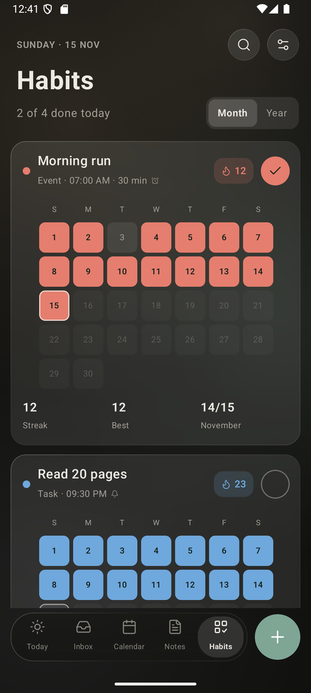
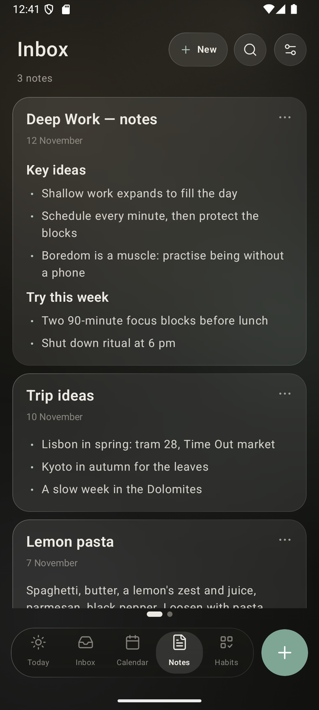
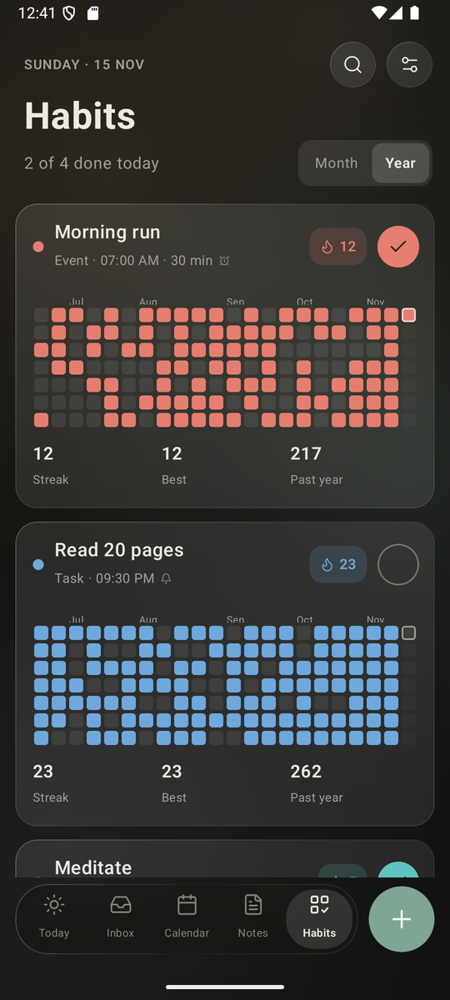
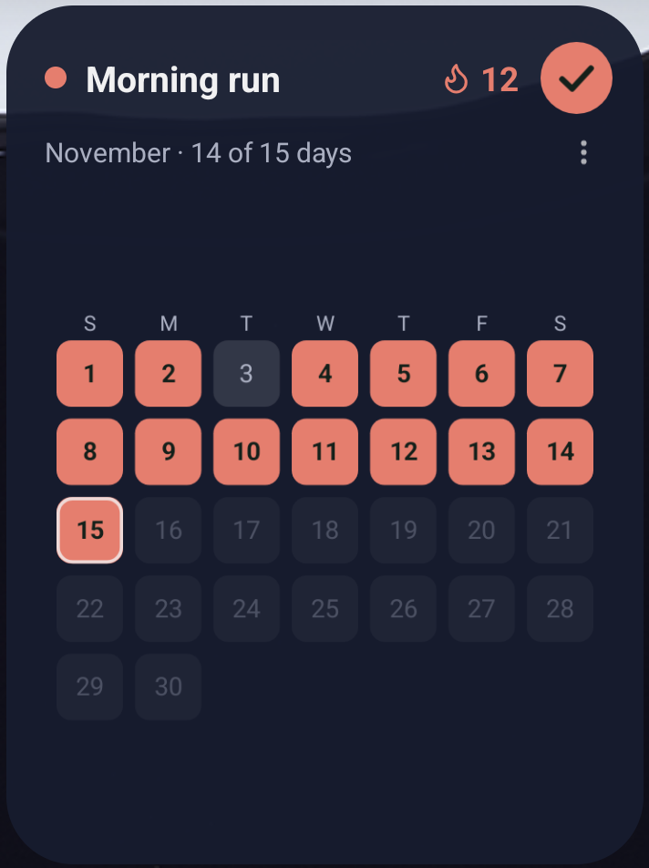
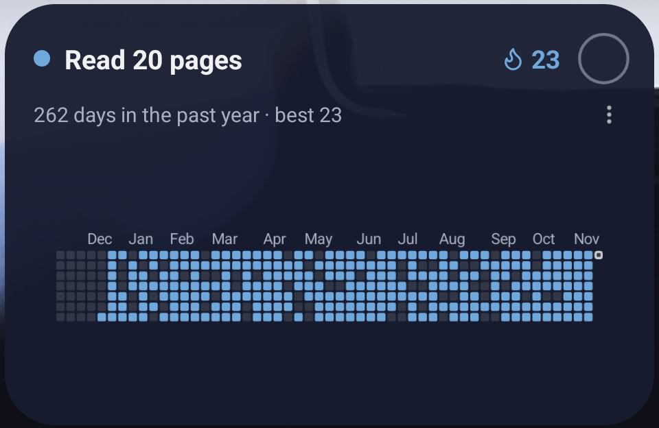

<p align="center">
  
</p>

<h1 align="center">Daymark</h1>

<p align="center">
  A calm, private planner for Android: to-dos, calendar, notes and habits in one place.<br>
  Everything stays on your phone.
</p>

<p align="center">
  <a href="../../releases/latest"><b>Download the latest APK</b></a>
  &nbsp;·&nbsp; Android 12 or newer
</p>

<p align="center">
  
  
  
  
</p>

## What it does

**Today** opens first: what's overdue, what's on today in time order, the habits you haven't checked in yet, and what's coming tomorrow.

**To-dos** live in folders (Inbox, Work, Home…). Add them by typing or by voice, star the important ones, give them a date and time, and let them repeat daily, on weekdays, weekly, monthly or yearly.

**Calendar** shows a week strip and a timeline of the day, with tasks, events and habits together. Swipe between days, and import events from the calendars already on your phone.

**Notes** are written as pages: headings, checklists, bullets, quotes, tables, images and drawings, with an optional cover image. Notes can be kept in folders.

**Saved** collects links, text and images shared from other apps through the Android share sheet. Links get their title and preview image, and you can add a comment of your own to anything you save.

**Private** keeps chosen notes and saves behind your fingerprint, face or screen lock. Hold the Notes tab to open it. Private items never appear in search or widgets, and screenshots are blocked while it's open.

**Habits** track the small things you do every day:
- Add a habit as a **task** (tick it off whenever) or an **event** (a set time and duration, shown on your calendar).
- Give it one of eight colours and an optional reminder.
- See your streak, your best run, and a month or a whole year of coloured squares. Tap any past day to fill it in.

<p align="center">
  
  
</p>

### Reminders

Any task, event or habit can remind you with a **notification** (with Done and Snooze buttons) or ring like an **alarm clock** on the lock screen. Reminders come back after a restart, and Daymark tells you if a phone setting would stop them from arriving.

### Widgets

Nine home-screen widgets:
- **Tasks**, compact and detailed
- **Calendar month**, compact and detailed
- **Events**, compact and detailed
- **Note**
- **Habit month** and **Habit year**, each with a check-in button

<p align="center">
  
  
</p>

### Also

- Search across everything from any tab.
- Undo after any delete.
- Back up to a single file and restore it on another phone.

## Privacy

Daymark has no account, no analytics and no ads. Your data is stored in the app's private storage on your phone and nowhere else.

The app uses the internet for one thing only: fetching the title and preview image of a link you save. It asks for calendar access only when you choose to import events.

## Install

1. On your phone, open the [latest release](../../releases/latest) and download the `.apk` file.
2. Open it. If Android asks, allow your browser or file manager to install apps.
3. To update, install the newer APK over the old one. Your data is kept.

Daymark needs Android 12 (API 31) or newer.

## Build from source

You'll need the Android SDK and JDK 17 or newer. Then run:

```sh
./gradlew assembleRelease
```

The APK is written to `app/build/outputs/apk/release/app-release.apk`. Use `./gradlew assembleDebug` for a debug build.

The app is written in Kotlin with Jetpack Compose. The sources are in `app/src/main/java/com/anmol/daymark/`:

| Area | Files |
| --- | --- |
| App state and navigation | `DaymarkApp.kt`, `Navigation.kt` |
| Data model and storage | `BoardModels.kt`, `Backup.kt` |
| Screens | `Today.kt`, `TodoScreens.kt`, `CalendarScreen.kt`, `NotesScreens.kt`, `NoteEditor.kt`, `SavedGrid.kt`, `Habits.kt`, `SettingsScreen.kt`, `Search.kt` |
| Reminders and alarms | `Reminders.kt`, `AlarmRinging.kt`, `ReminderSettings.kt` |
| Widgets | `TaskListWidget.kt`, `TaskCompactWidget.kt`, `MonthWidget.kt`, `CalendarWidget.kt`, `NoteWidget.kt`, `HabitWidgets.kt` |
| Look and feel | `Theme.kt`, `Glass.kt`, `Backdrops.kt`, `Icons.kt`, `Motion.kt` |

## Licence

Daymark is released under the [MIT Licence](LICENSE).
